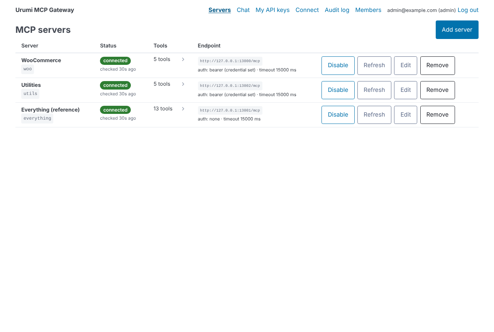
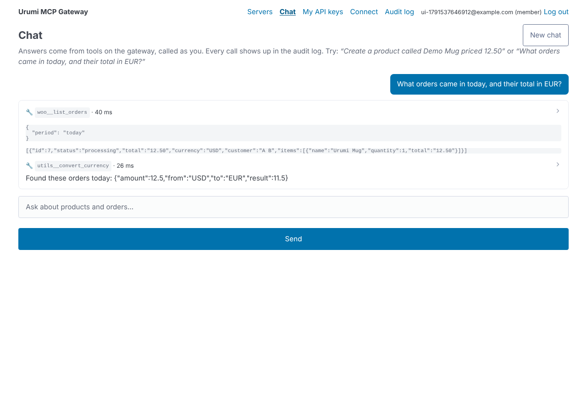

# mcp-gateway-k8

WooCommerce hosting with a team MCP gateway on Kubernetes (Urumi AI FDE internship, round 1).

**🎥 Demo video:** https://drive.google.com/drive/folders/1MoxsePgo56jV9cyjIA9r9V_L5xgASR8j?usp=sharing

- **[System design and tradeoffs](docs/design-and-tradeoffs.md)**: architecture, aggregation/routing/failure handling, what changes for production
- **[Threat model](docs/threat-model.md)**: shared credentials, no token passthrough, untrusted upstreams, member vs member
- **[Bonus / stand-out items](docs/standout.md)**: what's done, partial, not done
- **[Demo video script](docs/demo-script.md)**: the six required topics, with commands and talking points
- [PLAN.md](PLAN.md): the original build plan and decision log

**Status:** every layer is built and verified end to end. CI runs the suite on a real k3d cluster on every push, and `scripts/dod.sh` passed the full definition of done (35/35, two users, real LLM) on a MacBook with k3d. Stand-out items are tracked in docs/standout.md.

| Layer | State |
|---|---|
| Store: WordPress + WooCommerce + MariaDB on k8s, Helm, Ingress, probes, NetworkPolicies | ✅ |
| WooCommerce MCP server | ✅ |
| Gateway backend: one MCP endpoint over 3 upstreams, team, API keys, audit, REST API | ✅ |
| Dashboard UI (servers, members, keys, audit log, connect) | ✅ |
| Chat agent (LLM tool loop through the gateway, as the logged-in user) | ✅ |
| Chat agent | ⏳ |

## Prerequisites

- Docker
- [k3d](https://k3d.io) ≥ 5.6
- kubectl
- Helm 3

## Local setup

```bash
make up            # k3d cluster + helm install; returns once the store setup Job finishes (~3-5 min)
make status        # pods, services, ingress, PVCs, NetworkPolicies
make store-password
```

| URL | What |
|---|---|
| http://store.localtest.me | Storefront |
| http://store.localtest.me/wp-admin | WooCommerce admin (user `admin`, password from `make store-password`) |
| http://app.localtest.me | Gateway dashboard/API (user `admin@example.com`, password from `make admin-password`) |
| http://app.localtest.me/mcp | The single MCP endpoint (Streamable HTTP, `Authorization: Bearer <your key>`) |

### Local domain approach
`*.localtest.me` is a public DNS wildcard that resolves to `127.0.0.1`, so there's nothing to add to `/etc/hosts`. k3d maps host ports 80/443 to the cluster's Traefik ingress. If your DNS resolver blocks it, `*.127.0.0.1.nip.io` works the same way: set `global.domain`.

### Place an order
1. Open http://store.localtest.me/shop and add *Urumi Mug* to the cart.
2. Go to checkout, fill in any billing details, and choose **Cash on delivery**. Place the order.
3. The order appears in WP admin → WooCommerce → Orders.

The setup Job configures all of this, and every step is safe to re-run: it installs WordPress, WooCommerce and Storefront, enables COD, turns off coming-soon mode and shipping zones, creates sample products, and inserts the REST API key that woo-mcp will use. Its logs: `make setup-logs`.

### Use the dashboard
Log in at http://app.localtest.me as `admin@example.com` (`make admin-password`, or `make credentials` for every login).

| Page | Who | What |
|---|---|---|
| Servers | everyone | Status (Connected / Unreachable / Disabled) with the reason, tools per server. Admins add (URL + optional bearer/header credential), edit, disable, refresh, remove |
| Chat | everyone | Ask questions. Every tool call it made is shown and audited as you |
| My API keys | everyone | Create (shown once, with a ready-to-paste Claude Code command), revoke |
| Connect | everyone | Gateway URL and client snippets |
| Audit log | admin: everyone's · member: own | Who, server, tool, when, duration, outcome, error |
| Members | admin | Invite (copy the link; no SMTP), change role, disable, revoke anyone's key |



### Chat agent setup
The chat uses any OpenAI-compatible API. The default is the **NVIDIA API catalog** with `z-ai/glm-5.3-flash`. It's fast, its tool calling is reliable, and it passed the full definition-of-done run (`scripts/dod.sh`, 35/35) on a real cluster. Get a key (`nvapi-...`) at https://build.nvidia.com, then:

```bash
make deploy LLM_API_KEY=nvapi-...      # stored in the urumi-gateway Secret, never in git
```

To change provider or model on a running cluster without redeploying:
```bash
kubectl -n urumi patch secret urumi-gateway --type merge -p '{"stringData":{"LLM_API_KEY":"<key>"}}'
kubectl -n urumi set env deploy/urumi-gateway LLM_BASE_URL=<base-url> LLM_MODEL=<model>
```
List the models your key can use with `curl -s -H "Authorization: Bearer $KEY" <base-url>/models | jq -r '.data[].id'`. Providers retire model names often. A chat error like `LLM 404 ... model not found` means you should pick another model from that list. Other options: Groq `https://api.groq.com/openai/v1` + `openai/gpt-oss-120b` (verified; free tier is 8k tokens/min, and the gateway retries 429s automatically), Gemini `https://generativelanguage.googleapis.com/v1beta/openai` (free-tier quotas vary by model), OpenRouter, or a local Ollama `http://<host>:11434/v1` (no key).



### Connect an MCP client
Create an API key (dashboard → My API keys, or `POST /api/keys`). It's shown once. Then:

```bash
claude mcp add --transport http urumi http://app.localtest.me/mcp \
  --header "Authorization: Bearer mcpgw_xxxxxxxx_..."
```

Cursor: in `~/.cursor/mcp.json`, add `{"mcpServers":{"urumi":{"url":"http://app.localtest.me/mcp","headers":{"Authorization":"Bearer mcpgw_..."}}}}`.
MCP Inspector: `npx @modelcontextprotocol/inspector`, then transport *Streamable HTTP*, URL `http://app.localtest.me/mcp`, header `Authorization: Bearer mcpgw_...`.

You get every enabled server's tools, named `<server>__<tool>`: `woo__list_orders`, `utils__convert_currency`, `everything__echo`, and so on. Try *"what orders came in today, and what's their total in EUR?"*. It needs `woo` and `utils`.

### Test everything with curl
```bash
scripts/dod.sh      # the assignment's definition of done, step by step, two users, the real LLM
scripts/smoke.sh    # the CI suite (~50 checks); works without an LLM key
```
`dod.sh` creates a product through the chat agent, buys it on the storefront (COD), asks the agent and an MCP client (as user B) for today's orders, makes one call that uses two servers, revokes B's key, disables a server, kills an upstream, and checks the audit log. It's safe to re-run: unique names each run, and anything it disables is restored.

### Gateway behaviour in one table

| Situation | What happens |
|---|---|
| Two servers expose the same tool (`echo`) | Always prefixed: `utils__echo` vs `everything__echo`. Slugs are unique and immutable, so names never clash or change |
| Upstream slow | Per-server timeout (default 15 s) → tool result `upstream 'x' timed out after Nms`. Other servers unaffected |
| Upstream dead | Clear error (`ECONNREFUSED`), marked *unreachable* at once, its tools leave `tools/list`. The 10 s health poll brings it back automatically |
| Server disabled | Tools hidden immediately, direct calls denied |
| Key revoked | `401`. The attempt is still audited under the key's owner |
| Admin adds `http://169.254.169.254/...`, `10.x`, `localhost` | Rejected (SSRF guard). In-cluster upstreams must be on the `ssrf.allowedHosts` list |

## What runs where (namespace `urumi`)

| Workload | Kind | Storage | Exposure |
|---|---|---|---|
| `urumi-mariadb` | StatefulSet | PVC `data-urumi-mariadb-0` | headless Service, NetworkPolicy: WordPress + setup Job only |
| `urumi-wordpress` | Deployment (Recreate) | PVC `urumi-wordpress` | Ingress `store.<domain>`, NetworkPolicy: Traefik + woo-mcp only |
| `urumi-setup` | Job (Helm post-install/upgrade hook) | mounts the WordPress PVC | none |
| `urumi-woo-mcp` | Deployment | none | ClusterIP only, NetworkPolicy: gateway in, WordPress + DNS out |
| `urumi-gateway` | Deployment (1 local / 2 prod) | none (stateless) | Ingress `app.<domain>`, NetworkPolicy: Traefik in |
| `urumi-postgres` | StatefulSet | PVC `data-urumi-postgres-0` | headless Service, NetworkPolicy: gateway only |
| `urumi-utils-mcp`, `urumi-everything-mcp` | Deployment | none | ClusterIP only, NetworkPolicy: gateway in, DNS out |

Secrets: `urumi-gateway` holds the Postgres password, session secret, the AES key for upstream credentials, the bootstrap admin password, the utils-mcp token and the optional LLM key. `urumi-store` holds the DB passwords, the WP admin password and the WC REST key/secret. Helm generates them on first install and reuses them on upgrade (`lookup`). The Secret is kept on uninstall, so a retained DB volume stays usable. In prod they come from `existingSecret`.

## Production (k3s on a VPS)

```bash
curl -sfL https://get.k3s.io | sh -          # Traefik, local-path storage and NetworkPolicy enforcement included
helm repo add jetstack https://charts.jetstack.io
helm install cert-manager jetstack/cert-manager -n cert-manager --create-namespace --set crds.enabled=true
kubectl apply -f - <<'YAML'
apiVersion: cert-manager.io/v1
kind: ClusterIssuer
metadata: { name: letsencrypt-prod }
spec:
  acme:
    server: https://acme-v02.api.letsencrypt.org/directory
    email: you@example.com
    privateKeySecretRef: { name: letsencrypt-prod }
    solvers: [{ http01: { ingress: { ingressClassName: traefik } } }]
YAML
kubectl create ns urumi
kubectl -n urumi create secret generic urumi-store \
  --from-literal=MARIADB_ROOT_PASSWORD="$(openssl rand -hex 24)" \
  --from-literal=MARIADB_PASSWORD="$(openssl rand -hex 24)" \
  --from-literal=WP_ADMIN_PASSWORD="$(openssl rand -hex 12)" \
  --from-literal=WC_CONSUMER_KEY="ck_$(openssl rand -hex 20)" \
  --from-literal=WC_CONSUMER_SECRET="cs_$(openssl rand -hex 20)" \
  --from-literal=WOO_MCP_TOKEN="$(openssl rand -hex 24)"
kubectl -n urumi create secret generic urumi-gateway \
  --from-literal=POSTGRES_PASSWORD="$(openssl rand -hex 24)" \
  --from-literal=SESSION_SECRET="$(openssl rand -hex 32)" \
  --from-literal=CREDENTIALS_KEY="$(openssl rand -base64 32)" \
  --from-literal=BOOTSTRAP_ADMIN_PASSWORD="$(openssl rand -hex 12)" \
  --from-literal=UTILS_MCP_TOKEN="$(openssl rand -hex 24)" \
  --from-literal=LLM_API_KEY="<your key>"
# point DNS A records store.<domain> (and later app.<domain>) at the VPS, set global.domain in values-prod.yaml
make deploy ENV=prod
```

The only differences from local are in `charts/urumi/values-prod.yaml`: domain, TLS via cert-manager, volume sizes, `existingSecret`, and no sample products.

## Upgrade and rollback

```bash
helm history urumi -n urumi
make deploy                       # e.g. after bumping store.wordpress.image or store.site.wooVersion
helm rollback urumi <REVISION> -n urumi
```

The setup Job re-runs after every upgrade. It applies a pinned WooCommerce version and runs `wp wc update` for WC database migrations.

## Repo layout

```
charts/store    one WooCommerce store + its woo-mcp (reusable per store for the multi-store bonus)
charts/platform gateway + Postgres + utils-mcp + everything-mcp
charts/urumi    umbrella chart + values-local.yaml / values-prod.yaml
k3d/            local cluster config
apps/woo-mcp    WooCommerce MCP server (TypeScript, runs on Node 22 without a build step)
apps/gateway    MCP gateway + REST API (Express, Postgres, MCP SDK)
apps/utils-mcp  second upstream (currency, time, calculator, echo, sleep)
apps/everything-mcp  pinned official reference server image
scripts/        smoke.sh + smoke-gateway.sh: the end-to-end tests CI runs
```
